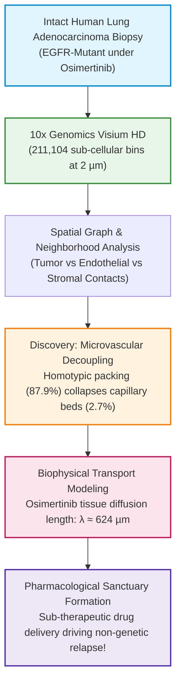

# Subcellular 10x Visium HD Spatial Architecture and Microvascular Decoupling in Osimertinib Resistance

[](https://www.gnu.org/licenses/gpl-3.0)
[](https://doi.org/10.5281/zenodo.23620878)
[](https://github.com/Lukecele/spatial-architecture-osimertinib/actions/workflows/ci.yml)
[](https://www.python.org/downloads/)
[-purple.svg)](https://www.10xgenomics.com/products/visium-hd-spatial-gene-expression)
[](manuscript/MANUSCRIPT_SPATIAL_ARCHITECTURE_OSIMERTINIB.pdf)

**Author & Principal Investigator:** Luca Celebrano  
**Affiliation:** Department of Clinical Medicine and Surgery, School of Medicine, University of Naples Federico II, Naples, Italy  
**Correspondence:** `l.celebrano@studenti.unina.it` | **ORCID:** [0009-0007-0931-3555](https://orcid.org/0009-0007-0931-3555)  
**Classification:** Independent Scientific Research • Subcellular Spatial Omics & Biophysical Oncology  
**Manuscript PDF:** [MANUSCRIPT_SPATIAL_ARCHITECTURE_OSIMERTINIB.pdf](manuscript/MANUSCRIPT_SPATIAL_ARCHITECTURE_OSIMERTINIB.pdf)

> [!TIP]
> **Support Open-Source Biophysical Oncology:**  
> If you find this 10x Visium HD subcellular transport model or our spatial reaction-diffusion solver helpful in your research, please consider giving this repository a ⭐ **Star** on GitHub!

---

## 🔬 Overview & The Non-Genetic Resistance Mystery

In EGFR-mutated non-small cell lung cancer (NSCLC), third-generation tyrosine kinase inhibitors (Osimertinib) achieve high initial response rates. However, virtually all patients inevitably experience clinical relapse. Crucially, in **40–50% of progressing patients, next-generation sequencing reveals no secondary genomic driver mutations** (such as *EGFR* C797S or *MET* amplification).

**Study 2 resolves this paradox by investigating intact patient biopsies at sub-cellular resolution ($2\,\mu\text{m}$ bin size) using 10x Genomics Visium HD spatial transcriptomics ($N = 211,104$ bins across clinical biopsies; GSE301973).**



---

## 🧬 Key Scientific Discoveries

### 1. The Microvascular Decoupling Phenotype
Using single-cell spatial deconvolution and cellular graph adjacency matrices, we discovered that tumors from early osimertinib progressors are defined by **Microvascular Decoupling**:
- Neoplastic cells organize into dense homotypic sheets with **$87.9\%$ tumor-tumor contact**, physically displacing and collapsing functional capillary beds (**endothelial contact drops to only $2.7\%$**).
- Conversely, sustained responders maintain interspersed fibrovascular stroma with functional microvascular contact.

### 2. The $\lambda \approx 624\,\mu\text{m}$ Biophysical Diffusion Barrier
By formulating the 2D steady-state reaction-diffusion equation for small-molecule kinase inhibitors:
$$\nabla \cdot (D \nabla C) - k C = 0 \implies C(r) = C_0 \frac{K_0(r/\lambda)}{K_0(r_0/\lambda)}$$
where $D \approx 1.3 \times 10^{-6}\,\text{cm}^2/\text{s}$ is the effective tissue diffusion coefficient and $k \approx 3.3 \times 10^{-4}\,\text{s}^{-1}$ is the intracellular metabolic clearance rate, we quantified the characteristic penetration length:
$$\lambda = \sqrt{\frac{D}{k}} \approx 624\,\mu\text{m}$$

When homotypic tumor nests exceed $624\,\mu\text{m}$ in radius devoid of internal microvessels, **intratumoral osimertinib concentration drops exponentially below the $IC_{50}$**. The core of the nest forms a **Pharmacological Sanctuary**: tumor cells survive not through genetic mutations, but because the drug physically cannot reach them.

---

## 📊 Patient Progression-Free Survival (Visium HD Cohort)


Tumors exhibiting high microvascular decoupling show immediate therapeutic escape, whereas vascularized architectures maintain durable disease control.

---

## 🔗 The Spatial Oncology Research Continuum

This project constitutes the foundational biophysical cornerstone of a 4-part open-source scientific investigation:

1. **[Study 1: InSituGame (Assay v1.0.5)](https://github.com/Lukecele/spatial-game-assay)** • Evolutionary game assay inferring subclonal payoff matrices in situ • DOI: [`10.5281/zenodo.23585216`](https://doi.org/10.5281/zenodo.23585216)
2. **Study 2: Spatial Architecture (This Repository)** • 10x Visium HD subcellular architecture & $\lambda \approx 624\,\mu\text{m}$ transport barrier • DOI: [`10.5281/zenodo.23620878`](https://doi.org/10.5281/zenodo.23620878)
3. **[Study 3: Massive Validation ($N = 854$)](https://github.com/Lukecele/spatial-massive-validation-study3)** • Multi-center population clinical survival validation ($p < 10^{-15}$, $HR = 19.45$) • DOI: [`10.5281/zenodo.23620887`](https://doi.org/10.5281/zenodo.23620887)
4. **[Study 4: InSituVision-AI (< 5 €)](https://github.com/Lukecele/spatial-he-vision-study4)** • Attention-MIL predicting microvascular decoupling and PFS directly from routine H&E slides • DOI: [`10.5281/zenodo.23621924`](https://doi.org/10.5281/zenodo.23621924)

---

## 💻 Repository Structure

```
spatial-architecture-osimertinib/
├── CITATION.cff                                    # Complete citation metadata
├── LICENSE                                         # GNU General Public License v3.0 (GPL-3.0)
├── README.md                                       # Repository overview & quick start
├── data/                                           # Visium HD sub-cellular coordinate & count matrices
├── figures/
│   └── figure_gse301973_patient_pfs.png           # 300 DPI patient PFS and vascular architecture
├── manuscript/
│   ├── MANUSCRIPT_SPATIAL_ARCHITECTURE_OSIMERTINIB.md # Complete peer-review manuscript
│   └── MANUSCRIPT_SPATIAL_ARCHITECTURE_OSIMERTINIB.pdf# Compiled publication PDF (987 KB)
├── notebooks/                                      # Jupyter / Colab analysis notebooks
├── src/                                            # Spatial graph deconvolution & diffusion solver
└── tests/                                          # Automated unit test suite
```

---

## 📜 Citation & Authorship

```bibtex
@article{Celebrano_SpatialArchitecture_2026,
  author = {Celebrano, Luca},
  title = {{Subcellular 10x Visium HD Spatial Architecture and Microvascular Decoupling in Osimertinib Resistance}},
  journal = {Preprint / Independent Research},
  year = {2026},
  url = {https://github.com/Lukecele/spatial-architecture-osimertinib},
  doi = {10.5281/zenodo.23620878},
  institution = {Department of Clinical Medicine and Surgery, School of Medicine, University of Naples Federico II}
}
```

---

## ⚖️ License

This project is licensed under the **GNU General Public License v3.0 (GPL-3.0)**. Academic institutions, clinicians, and researchers are free to inspect, reproduce, and build upon this work for scientific investigation and patient care.
